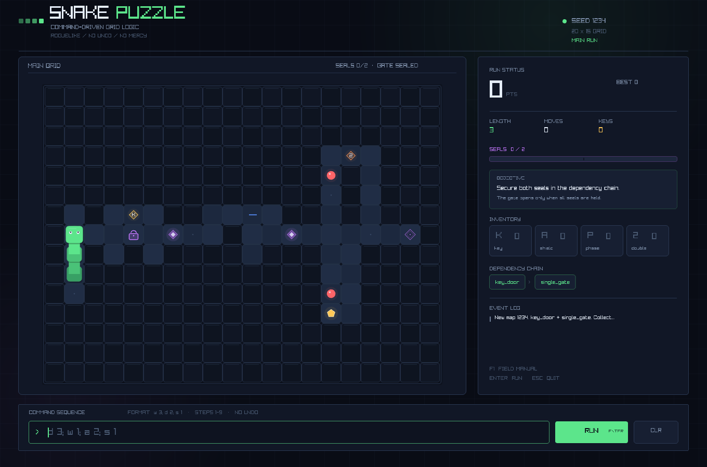
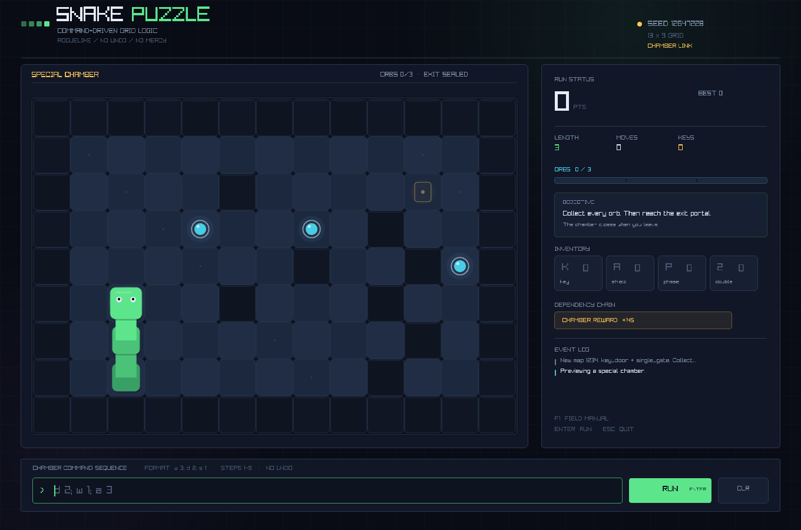
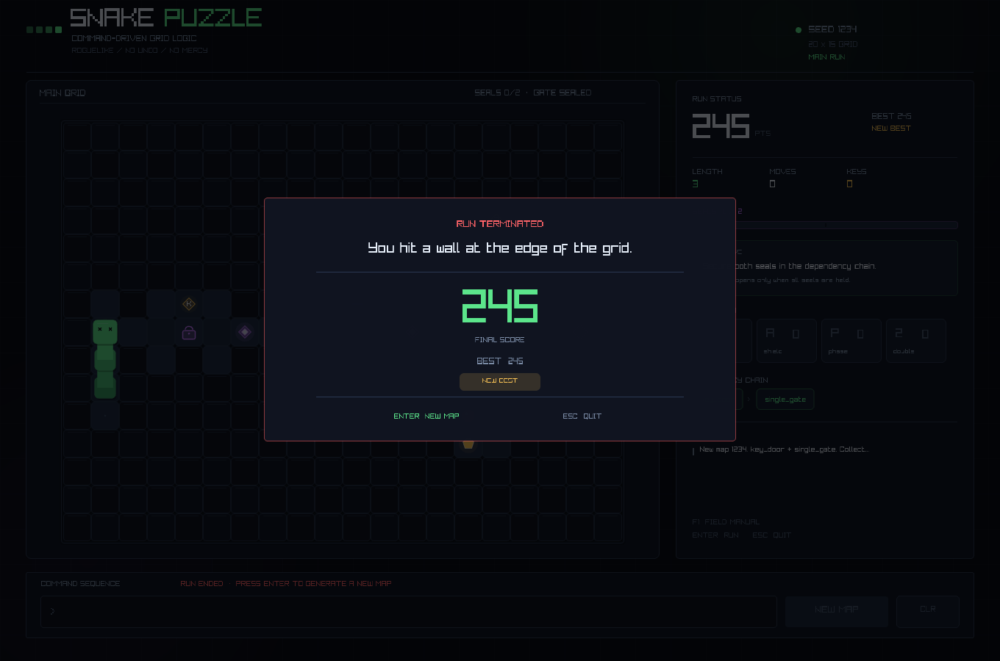
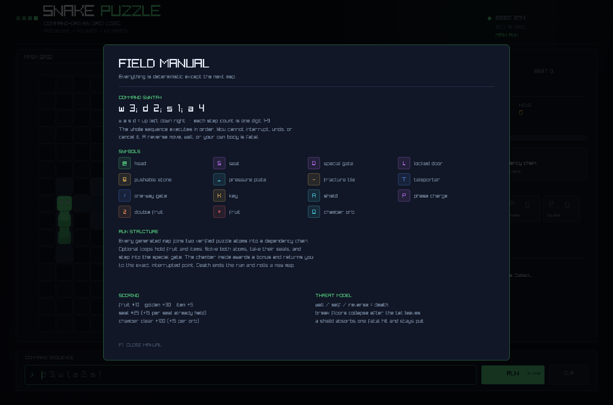

# Snake Puzzle

**指令驱动的网格解谜贪吃蛇 × 纯肉鸽。** 观察一张随机生成、可验证的机关地图，预判蛇身占位、推石与单向门，输入一条不可中断的移动指令序列，然后看着它一步步执行。

- 无局外成长、无模式菜单、无持久化解锁、无 Undo。
- 唯一成长是玩家对空间和机关的理解。
- C11 运行时 + raylib 图形界面；Python 只做离线工具链。
- 每一张地图都带有一条经过**真实游戏引擎逐步模拟**的参考解。

GitHub: <https://github.com/Arkee-Z/snake-puzzle>



| 特殊小关卡 | 局末结算 |
| --- | --- |
|  |  |



---

## 快速开始

### 依赖

- C11 编译器（macOS 上使用 Clang 测试）
- [raylib](https://www.raylib.com/) 6.0（macOS 上以 raylib 6.0 测试）
- `pkg-config`
- Python 3.10+（仅离线工具）

macOS：

```bash
brew install raylib pkg-config
```

Debian/Ubuntu 可尝试：

```bash
sudo apt install build-essential pkg-config libraylib-dev
```

### 构建与运行

```bash
make
./build/snake_puzzle --seed 1234
```

不指定 `--seed` 时使用时间种子。种子会显示在右上角，便于复现同一张地图。

```bash
# 固定种子 + 调整每步动画速度
./build/snake_puzzle --seed 1234 --step-ms 180

# 校验单张地图并导出可视化 dump
./build/snake_puzzle --validate-seed 1234 --dump build/map.txt
python3 tools/visualize_map.py build/map.txt

# 批处理统计
python3 tools/batch_sim.py --count 200 --seed 1000
```

---

## 玩法

### 输入指令

格式为 `方向 步数`，方向是 `w/a/s/d`，步数只能是 `1-9`。多条指令用分号分隔：

```text
d 3; w 1; a 2; s 1
```

- 在底部输入框键入，按 `Enter` 或点击 `RUN` 执行。
- 整条序列立即按顺序执行，执行过程中不能输入、撤销或中断。
- 反向移动、撞墙、撞到蛇身都会死亡。
- 在特殊门前进入小关卡时，主路线序列会暂停；通关后回到原位置并继续剩余步骤。

> 提示：输入框只接受 `wasd`、`1-9`、空格和分号。按 `Backspace` 删除。

### 目标

1. 穿过由两个预制原子拼接成的机关链。
2. 取得全部 `S` 封印。
3. 进入 `D` 特殊门。
4. 在小关卡中收集全部 `O` 球，再走到出口 `E`。
5. 带着奖励分回到主地图，继续累计分数，直到死亡。

### 图例

| 符号 | 含义 |
| --- | --- |
| `@` / `o` | 蛇头 / 蛇身 |
| `#` | 墙壁 |
| `*` / `$` | 普通食物 / 金色食物 |
| `S` | 封印（核心原子出口） |
| `D` | 特殊门 |
| `L` / `+` | 上锁门 / 已打开 |
| `_` / `=` | 压力开关 / 已压下 |
| `B` | 可推动石块 |
| `<` `>` `^` `v` | 单向门（只允许沿箭头方向进入） |
| `~` / `x` | 断裂地板 / 已塌陷深坑 |
| `T` | 传送点（成对） |
| `K` / `A` / `P` / `2` | 钥匙 / 护盾 / 穿墙 / 双倍分数 |
| `O` | 小关卡球 |
| `E` / `e` | 已开启 / 未开启的小关卡出口 |

### 功能地形与道具

| 机制 | 规则 |
| --- | --- |
| 上锁门 | 拥有钥匙时踏入即消耗一把钥匙并永久打开；没有钥匙视为致命碰撞 |
| 单向门 | 仅允许沿箭头方向进入，反向或侧向进入视为墙 |
| 压力开关 | 蛇头或石块压上后永久触发，打开该原子内全部上锁门 |
| 可推石块 | 沿推动方向滑行，直到撞墙、机关、实体或压力开关；停在开关上会触发机关 |
| 传送点 | 成对出现，踏上后立即传送到另一侧；落点被占用会死亡 |
| 断裂地板 | 蛇头经过后标记，尾部离开时永久塌陷成深坑 |
| 护盾 | 吸收一次致命碰撞，本次移动取消，序列继续 |
| 穿墙 | 下一次进入墙时溶解该墙并消耗 |
| 双倍 | 下一颗食物分数翻倍 |
| 特殊小关卡 | 核心封印集齐后开启；进入后收集全部球并到达出口，获得奖励并返回 |

### 计分

| 事件 | 分数 |
| --- | ---: |
| 普通食物 | +10 |
| 金色食物 | +30 |
| 道具 | +5 |
| 第 n 个封印 | +25 + 15 × 已持有封印数 |
| 小关卡球 | +15（本地展示） |
| 小关卡通关奖励 | +100 + 15 × 球数 |

最高分是**进程内会话最高分**，不会写入磁盘。死亡后按 `Enter` 或点击 `NEW MAP` 会立即用新种子生成下一局。

---

## 程序化生成

每局地图不是随机撒点，而是：

1. 从 `assets/atoms/` 加载预制谜题原子。
2. 用加权随机选择两个兼容原子（入口行、尺寸、总宽约束）。
3. 建立线性依赖图，保证无环。
4. 在 20×15 网格上刻出安全起点、原子链、特殊门和随机奖励回环。
5. 在原子出口放置封印；特殊门要求全部封印。
6. 将原子的参考解自动拼接成整张地图的参考指令序列。
7. 用真实 `game_step` 在副本上逐步模拟参考解；死亡、未进入特殊门或封印数不足即重试。
8. 保留奖励回环、食物、道具、种子和完整统计，输出可复现地图。

生成器是确定性的：相同 seed + 相同原子库 + 相同尺寸会得到相同地图。失败会自动重试，最多 48 次。

### 原子配置

原子是外部文本文件，新增原子不需要改 C 代码：

```text
name key_door
difficulty 1
weight 4
layout
#####
#.K.#
E.L.X
#.#.#
#####
end
solution
d 1; w 1; d 1; s 1; d 2
end
```

- `E` 必须位于西边缘，`X` 位于同一行的东边缘。
- 布局最大 10×10；生成器按入口行水平拼接。
- `solution` 是供验证器与生成器使用的参考解。
- 详细标记表见 [`assets/atoms/README.md`](assets/atoms/README.md)。
- 离线校验：`python3 tools/validate_atoms.py`。
- 导出 C 可加载的紧凑 SPA1：`python3 tools/export_atoms.py --output build/atoms.spa`。
  然后可用 `./build/snake_puzzle --atoms build/atoms.spa --batch 20` 加载。

当前原子库：

| 原子 | 机制 |
| --- | --- |
| `key_door` | 钥匙→上锁门 |
| `push_block` | 推石入封闭压力槽 |
| `single_gate` | 单向门绕行 |
| `teleport_fold` | 成对传送点误导 |
| `break_floor` | 一次性断裂地板 |

---

## 工具链

所有 Python 工具均为离线分析，不参与游戏运行：

```bash
# 1. 独立校验每个原子，并输出参考解
python3 tools/validate_atoms.py

# 2. 终端可视化生成器导出的地图
./build/snake_puzzle --validate-seed 42 --dump build/map42.txt
python3 tools/visualize_map.py build/map42.txt

# 3. 调用 C 生成器批量统计可解率、依赖链、机关密度
python3 tools/batch_sim.py --count 500 --seed 1000
python3 tools/batch_sim.py --count 500 --seed 1000 --json

# 4. 导出紧凑 SPA1 原子库
python3 tools/export_atoms.py --output build/atoms.spa
```

`make tools-test` 会串联原子校验、SPA 导出和 C 端加载批处理。

### 无窗口命令

```bash
./build/snake_puzzle --batch 100 --seed 1000
./build/snake_puzzle --validate-seed 42 --dump build/map42.txt
./build/snake_puzzle --list-atoms
./build/snake_puzzle --help
```

批处理输出 JSON Lines，字段包括 `valid`、`attempts`、`atoms`、`branches`、`density`、`witness_steps`、`chain_length` 等。这些模式不会初始化 raylib 窗口。

---

## 项目结构

```text
snake_puzzle/
├── Makefile
├── include/snake_puzzle/
│   ├── app.h
│   ├── core/          # board, snake, command, event, game, rng, score
│   ├── entity/        # terrain, item, food, door
│   ├── gen/           # atom, dependency, generator, validator, solver
│   └── ui/            # render_cli, render_raylib
├── src/
│   ├── main.c
│   ├── app.c
│   ├── core/
│   ├── gen/
│   ├── entity/
│   └── ui/
├── assets/atoms/      # 外部谜题原子
├── tools/             # Python 离线工具
├── tests/             # C 单元与集成测试
└── docs/              # 架构文档、截图
```

- `core/` 不包含任何 raylib 头文件；CLI/dump/测试与图形 UI 共享同一套规则。
- 地形行为表在 `entity/terrain.c`，道具定义表在 `entity/item.c`。
- 移动、推石、开关、传送、死亡等全部变成事件，由 UI/测试消费。
- `app.c` 负责运行流程，不依赖 raylib；`ui/render_raylib.c` 只消费 `App` 状态。
- 更多设计说明见 [`docs/ARCHITECTURE.md`](docs/ARCHITECTURE.md)。

---

## 测试

```bash
make test       # C 单元 / 集成测试
make check      # 测试 + Python 工具链 + SPA 导出 + C 加载
```

`make test` 覆盖：

- 指令解析：合法序列、空格、大小写、尾分号、越界步数、空输入、过多久序列。
- 蛇与棋盘：初始化、增长、尾格移动、自身占位、边界。
- 规则：食物增长、双倍、撞墙、反向、护盾、钥匙门、单向门、推石压板、断裂地板、传送、穿墙、自咬、特殊门进入/返回值。
- 生成：多种子合法性、原子/封印/奖励分支、确定性复现、小关卡生成。
- 求解/验证：参考解逐步模拟、故意失败参考解、可达性 BFS。
- 应用层：命令提交、真实参考解跑通、特殊关卡暂停/结算、死亡后新局。

当前为 **639 checks, 0 failures**。

GitHub Actions 会运行核心测试、原子校验和 SPA 导出。

---

## 设计边界

- **没有**局外成长、模式选择、持久化解锁、Undo、剧情结局。
- 最高分只存在于当前进程；退出即清空。游戏不写存档。
- 原子目前固定为“西进东出”的水平模板；生成器随机选择原子、奖励回环和分支位置，而不是任意旋转摆放。
- 主链原子内的参考解会经过完整引擎模拟；但“任意长度蛇身 + 任意错误推石后仍可解”是玩家决策造成的局面，生成器只保证初始局面与参考路线可解。
- 小关卡生成使用连通性验证和“球不得位于死胡同”的局部约束；它不是完整的状态空间最优解证明。
- 图形界面需要桌面/OpenGL；所有批量验证和测试都能无窗口运行。

## License

MIT © 2026 Arkee-Z
